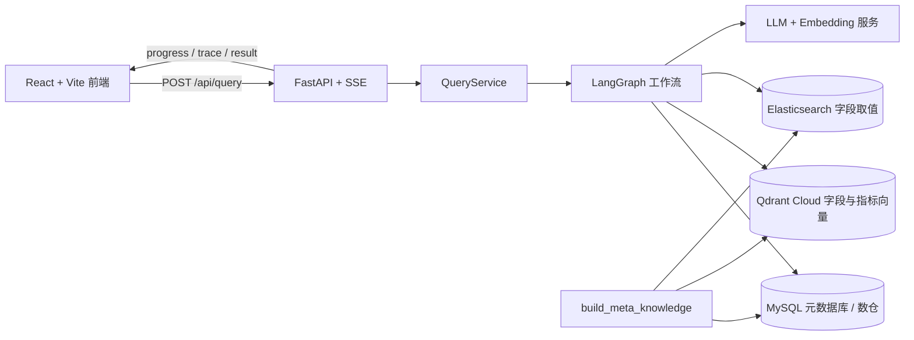
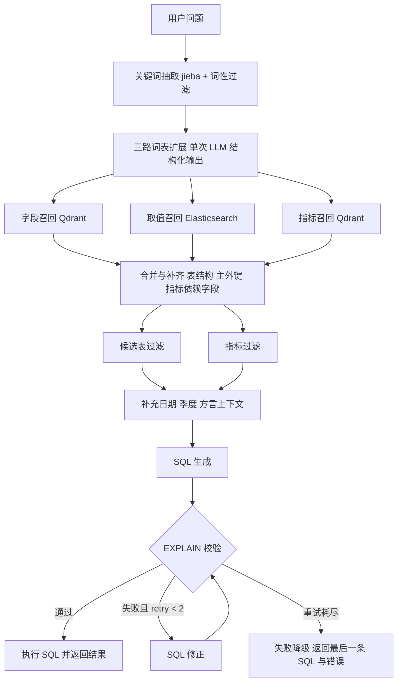

<div align='center'>
  <h1 style="margin-top: 15px;">电商问数 Agent</h1>
  <h4><b>shopkeeper-agent</b></h4>
  <p><em>基于 LangGraph 的固定 DAG Text-to-SQL 工作流：可评测、可终止、可重建、可容错</em></p>
</div>

<div align='center'>


</div>

## 项目来源

本项目基于开源教程项目 [didilili/shopkeeper-agent](https://github.com/didilili/shopkeeper-agent) 二次开发。原项目已提供电商数仓、元数据知识库以及「三路召回 → SQL 生成/校验/修正/执行」的完整链路；本仓库在此基础上完成评测体系、编排可控化、索引幂等、关键词扩展合并与云端接入适配，并用同一套评测集记录改造前后的差异。

## 项目定位

业务同学不会写 SQL，也很难记住表结构、字段含义、指标口径和字段取值。把自然语言问题直接交给大模型，常见失败是选错表、选错字段、理解错指标和 SQL 幻觉。

本项目把这条链路拆成可控的固定工作流：先召回相关字段、指标和字段取值，再由模型分步推理生成 SQL，校验并执行后以 SSE 流式返回结果。改造的重点不是新增功能，而是让链路具备工程属性：效果能评测、失败能终止、索引能重建、外部依赖抖动可收敛。

## 核心能力

- **三路混合召回**：字段与指标走 Qdrant 向量检索，字段取值走 Elasticsearch 全文检索，命中后由 MySQL 补齐表结构、主外键与指标依赖字段。
- **固定 DAG 编排**：LangGraph 串联关键词抽取、扩展、三路召回、上下文合并、表/指标过滤、SQL 生成/校验/修正/执行，路径确定、成本可控、易排障。
- **双通道评测**：20 题评测集，节点级召回与端到端执行分开跑，支持基线报告逐项 diff。
- **可控闭环**：SQL 修正最多 2 次，超限走失败降级并返回可读错误；每个节点写入耗时、状态与异常。
- **幂等元数据构建**：稳定 ID + upsert + 构建后差集对账，重复执行不膨胀、不冲突、不留幽灵数据。
- **外部依赖容错**：LLM 与 Embedding 具备重试与超时，Qdrant 检索对传输异常做指数退避。

## 架构



| 主线 | 内容 | 涉及模块 |
| --- | --- | --- |
| 元数据知识库构建 | 抽取表、字段、指标与字段取值，幂等写入三类存储，构建后对账清理 | MySQL / Qdrant / Elasticsearch / Embedding |
| 自然语言问数 | 召回、上下文合并、SQL 生成校验执行，流式返回进度与结果 | LangGraph / FastAPI / SSE / React |

## 问数工作流



关键设计点：

- **先召回再生成**：把「选表、选字段、理解口径」交给检索，避免模型凭训练知识猜表结构。
- **固定 DAG 而非 ReAct**：问数步骤稳定、路径可预测，固定图成本低、可观测、易定位失败节点。
- **字段用向量、取值用 ES**：字段与指标是语义匹配，取值是字面匹配；ES 的分词对枚举值、地名更稳。
- **检索结果不直接进上下文**：先合并去重、补齐依赖字段与主外键，再做表/指标过滤，控制提示词体积。

## 技术栈

| 模块 | 技术 | 作用 |
| --- | --- | --- |
| 数仓 | MySQL 8.0 | 事实表、维度表与分析型查询环境 |
| 元数据库 | MySQL + SQLAlchemy | 表、字段、指标、字段指标关系 |
| 向量检索 | Qdrant Cloud | 字段与指标的多视角向量索引 |
| 全文检索 | Elasticsearch 8.x | 字段真实取值与枚举值 |
| Embedding | OpenAI 兼容接口（阿里云百炼） | 文本向量化，无需本地部署模型 |
| 智能体编排 | LangGraph | 固定 DAG、条件边、节点 trace |
| 模型接入 | LangChain / langchain-openai | 统一调用、重试与超时控制 |
| 后端 | FastAPI | 依赖注入、生命周期、SSE 流式响应 |
| 前端 | React 19 + Vite + Tailwind CSS | 聊天式问数界面与流程展示 |
| 日志 | loguru + ContextVar | 并发请求 request_id 追踪 |
| 依赖管理 | uv / pnpm | 后端与前端依赖 |

## 目录结构

```text
shopkeeper-agent/
├── app/
│   ├── agent/            # 图、状态、运行时上下文、trace 装饰器、各节点
│   ├── api/              # 路由、依赖注入、生命周期、请求/响应结构
│   ├── clients/          # MySQL、Qdrant、Elasticsearch、Embedding 客户端管理
│   ├── conf/             # 配置 dataclass 与加载工具
│   ├── core/             # 日志、request_id 上下文
│   ├── entities/         # 业务实体（仓储层出口统一转换）
│   ├── models/           # SQLAlchemy ORM 模型
│   ├── prompt/           # Prompt 加载工具
│   ├── repositories/     # MySQL / Qdrant / ES 数据访问，含对账与重试
│   ├── scripts/          # 元数据构建、离线评测
│   └── services/         # 元数据构建服务、问数编排服务
├── conf/                 # app_config.yaml、meta_config.yaml
├── docker/               # docker-compose（仅 ES）、MySQL 初始化 SQL
├── evaluation/           # 评测集与各阶段报告
├── frontend/             # React + Vite 前端
├── plan/                 # 改造计划与阶段性总结
├── prompts/              # 关键词扩展、过滤、SQL 生成与修正模板
├── main.py               # FastAPI 入口
└── pyproject.toml
```

## 快速开始

### 1. 环境要求

- Python >= 3.14 与 [uv](https://docs.astral.sh/uv/)
- MySQL 8.0（本地安装，不使用 Docker）
- Docker（仅启动 Elasticsearch）
- Node.js 与 pnpm（前端）
- 阿里云百炼 API Key（LLM 与 Embedding 共用）
- Qdrant Cloud 集群地址与 API Key

### 2. 克隆与安装

```bash
git clone https://github.com/lrbwhite/shopkeeper-agent.git
cd shopkeeper-agent
uv sync
```

### 3. 配置密钥

```bash
cp .env.example .env
```

```bash
DASHSCOPE_API_KEY=your_dashscope_api_key
QDRANT_API_KEY=your_qdrant_api_key
```

在 `conf/app_config.yaml` 中确认：

- `qdrant.url`：Qdrant Cloud 集群地址
- `llm.model_name` / `llm.base_url`：OpenAI 兼容的模型服务
- `embedding.base_url` / `embedding.model`：OpenAI 兼容的 Embedding 服务
- `db_meta` / `db_dw`：本地 MySQL 连接信息

### 4. 初始化 MySQL

先创建账号（默认配置为 `didilili / dili123`，可修改配置）：

```sql
CREATE USER IF NOT EXISTS 'didilili'@'localhost' IDENTIFIED BY 'dili123';
```

再导入初始化脚本。脚本负责建库与授权，不会自动创建用户：

```bash
mysql -u root -p < docker/mysql/meta.sql
mysql -u root -p < docker/mysql/dw.sql
```

### 5. 启动 Elasticsearch

```bash
docker compose -f docker/docker-compose.yaml up -d
```

Compose 中仅保留 Elasticsearch（9200 端口）。MySQL 本地安装，Qdrant 与 Embedding 使用云端服务；Kibana、MySQL、Qdrant 容器均已注释。

### 6. 构建元数据知识库

```bash
uv run python -m app.scripts.build_meta_knowledge -c conf/meta_config.yaml
```

脚本将表字段写入 MySQL、字段与指标向量写入 Qdrant、字段取值写入 Elasticsearch，构建结束后对三处存储做差集对账。

构建是幂等的，可连续执行两次验证：MySQL 行数、Qdrant points、ES docs 数量应保持一致。

### 7. 启动后端

```bash
uv run fastapi dev main.py
```

接口：

```text
POST http://127.0.0.1:8000/api/query
```

```json
{
  "query": "统计华北地区的销售总额"
}
```

SSE 消息类型：

| 类型 | 含义 |
| --- | --- |
| progress | 节点执行进度 |
| trace | 节点耗时、状态与错误 |
| result | 最终查询结果 |
| error | 全局异常或 SQL 重试耗尽 |

### 8. 启动前端

```bash
cd frontend
pnpm install
pnpm dev
```

前端默认通过 Vite 代理把 `/api` 转发到 `http://127.0.0.1:8000`，可通过 `frontend/.env` 的 `VITE_DEV_PROXY_TARGET` 修改。

## 评测

### 评测集

`evaluation/questions.jsonl` 共 20 题，覆盖五类问题：单表聚合、多表 Join、指标口径、字段取值过滤、相对时间。每题标注期望字段、指标、取值、表与 SQL 关键词。

### 双通道

```bash
# 全量：召回 + 端到端
uv run python -m app.scripts.evaluate --mode all

# 节点级召回，与基线对比
uv run python -m app.scripts.evaluate \
  --mode recall --baseline evaluation/before_p1_1_recall.json

# 端到端，与基线对比
uv run python -m app.scripts.evaluate \
  --mode e2e --baseline evaluation/before_p1_1_e2e.json

# 小样本快速回归
uv run python -m app.scripts.evaluate --mode recall --limit 4
```

常用参数：`--mode recall|e2e|all`、`--limit N`、`--questions <jsonl>`、`--output <path>`、`--baseline <path>`。

报告附带 git commit、LLM 模型与 Embedding 模型；`--baseline` 会逐项打印 delta。单题失败（扩展超时、召回异常）只记录 `error` 并继续，不会中断整轮。

### 当前结果（commit `1b4aa8c`）

| 指标 | 结果 | 说明 |
| --- | --- | --- |
| 字段召回覆盖率 | 0.9833 | 20 题全量，命中率 1.00 |
| 指标召回覆盖率 | 0.8571 | 仅 q005 一题未命中，修复规则待验证 |
| 取值召回覆盖率 | 1.00 | — |
| 平均候选数（字段/指标/取值） | 6.8 / 0.95 / 0.35 | 字段候选较基线 4.8 上升 |
| 端到端成功率 | 1.00 | 4 题抽样 |
| 平均 LLM 调用次数 | 4.0 | 关键词扩展合并前为 6 次 |
| 平均 token | 6,134 | 同 4 题改造前 7,222，下降约 15% |
| P50 / P95 延迟（4 题） | 54.0s / 56.3s | 样本过小，不作结论 |

### 阶段对比

| 阶段 | commit | 字段覆盖率 | 指标/取值 | 端到端成功率 | 调用/题 | token/题 |
| --- | --- | --- | --- | --- | --- | --- |
| 初始基线 | 0ab1410 | 0.8778 | 1.00 / 1.00 | 0.50 | 4.5 | 5,354 |
| 关键词扩展合并前 | 918734f | 0.9583 | 1.00 / 1.00 | 0.95 | 5.85 | 7,688 |
| 关键词扩展合并后 | 1b4aa8c | 0.9833 | 0.8571 / 1.00 | 4 题 1.00 | 4.0 | 6,134 |

说明：

- 20 题属于小样本，单次结果会随模型服务波动；报告绑定 commit 与模型，用于同配置下的前后对比，而非横向排名。
- 初始基线成功率 0.5、调用数偏低，是因为索引重复写入与缺少重试导致题目提前失败，不能与后续阶段直接比较。
- 阶段之间切换过模型与向量库接入方式，跨版本差异包含环境因素。

## 已知问题

- **指标召回 q005**：期望指标 GMV 未命中，指标覆盖率 0.8571。同义扩展规则已写入 prompt，尚未验证、未提交。
- **字段候选噪声**：平均候选数从 4.8 升至 6.8，覆盖率达标但会挤占上下文，计划由检索增强解决。
- **全量端到端未复跑**：关键词扩展合并后只有 4 题样本，全量成功率与 P50/P95 待补。
- **合并调用的约束衰减**：合并为单次调用后，模型对「必需字段/指标」的纪律弱于三份专用 prompt，需要逐类补强制项。详见 `plan/P1-1_改造总结.md`。

## 后续规划

1. **召回批量化与并发化**：召回节点内部仍是逐关键词串行 `aembed_query` + `search`，改为批量向量化、`asyncio.gather` 并发检索并配 `Semaphore` 限制并发。
2. **检索增强**：Qdrant payload 过滤、向量与关键词结果 RRF 融合、top-20 精排取 top-5。
3. **检索缓存**：精确缓存与语义缓存，带过期策略并记录命中率。
4. **SQL 安全**：解析 SQL 并做只读白名单校验，仅允许 SELECT。
5. **交互能力**：多轮会话改写、前端 trace 与召回过程可视化。

本仓库不覆盖生产治理能力，例如登录与数据权限、多租户隔离、SQL 审计、监控告警与灰度发布。

## 简历表述

> 电商数仓问数 Agent（基于开源 LangGraph 项目二次开发）
>
> - 基于 LangGraph 编排「关键词抽取 → 三路并行召回 → 上下文合并 → SQL 生成/校验/修正/执行」的固定 DAG 问数链路；新增 SQL 修正上限 2 次与失败降级节点，避免错误 SQL 无限重试或异常中断流式响应。
> - 自建 20 题评测集与双通道评测脚本（节点级召回 + 端到端执行），覆盖召回覆盖率、执行成功率、P50/P95 延迟、LLM 调用数与 token；字段召回覆盖率 95.8% → 98.3%，指标/取值召回 100%。
> - 将字段、指标、取值三路关键词扩展合并为单次结构化输出，单题 LLM 调用 6 → 4 次、token 下降约 15%，并消除三路语义不一致。
> - 元数据构建改造为幂等可重入：Qdrant 使用 uuid5 稳定 ID + upsert，MySQL 使用 ON DUPLICATE KEY UPDATE，构建后对三类存储做差集对账，解决索引膨胀、主键冲突与残留脏数据。

## License

MIT，见 [LICENSE](LICENSE)。原项目版权归 didilili 所有。
